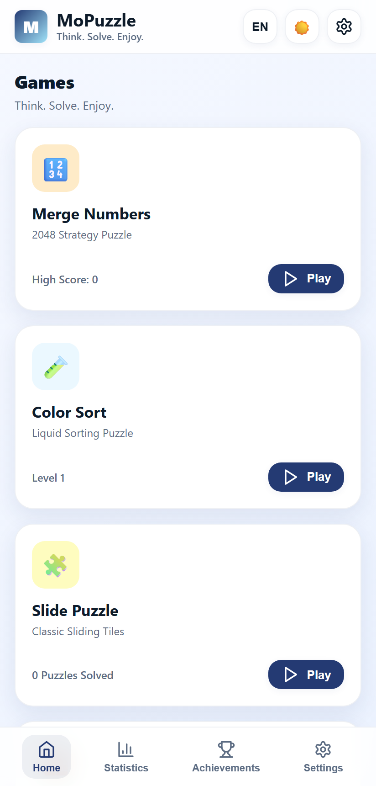
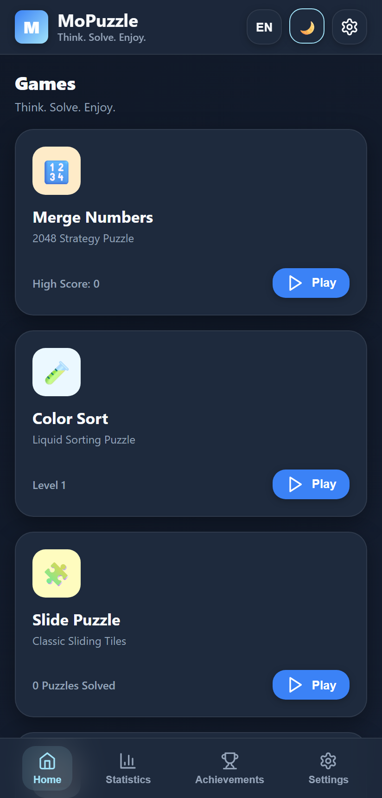
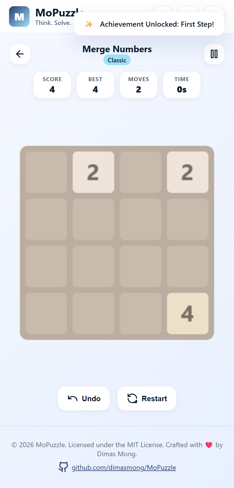
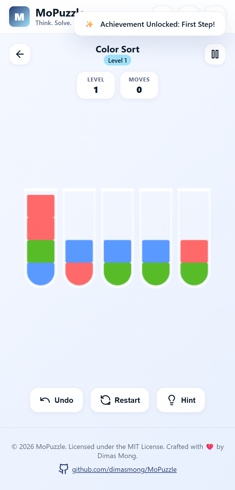
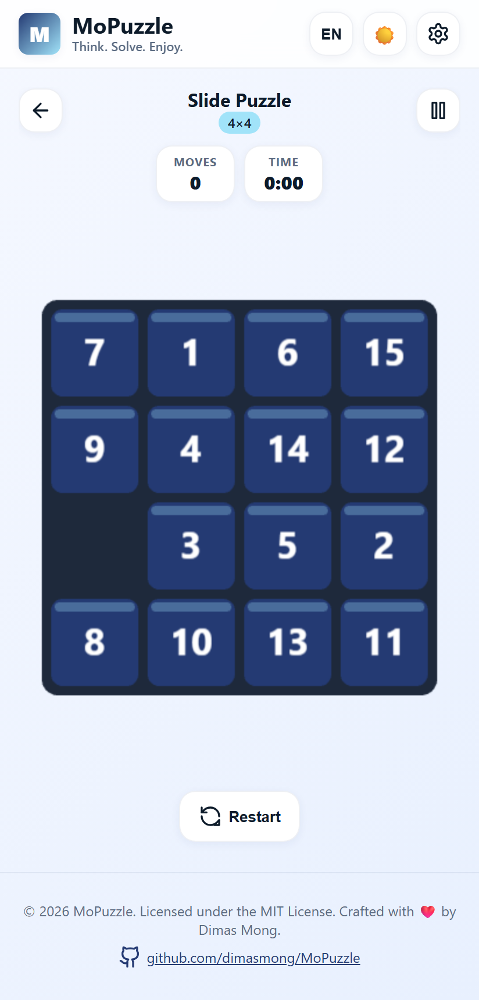
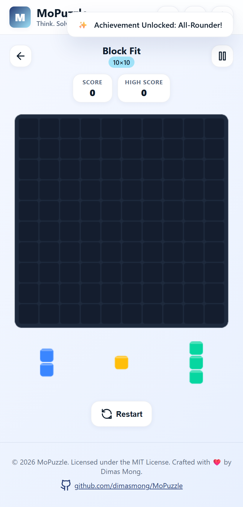
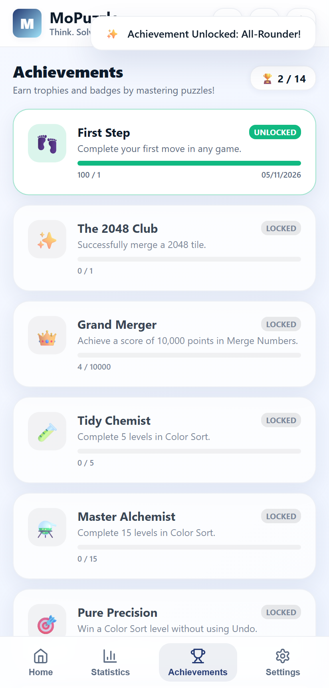
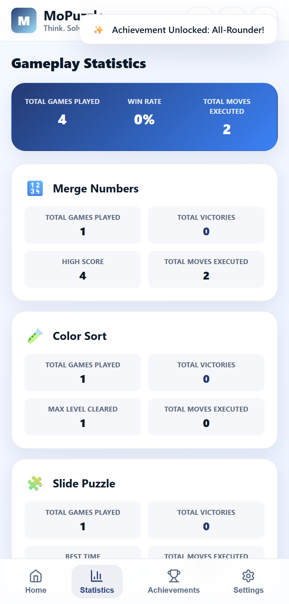

# MoPuzzle

> **Think. Solve. Enjoy.**

A complete, modern browser-based puzzle game collection crafted with TypeScript, Phaser 3, Vite, and HTML5/CSS3. Zero logins, zero paywalls, fully client-side, installable as a PWA, and playable offline anywhere.

[](LICENSE)
[](https://www.typescriptlang.org/)
[](https://phaser.io/)
[](https://vitejs.dev/)
[](https://web.dev/progressive-web-apps/)
[](https://mopuzzle.vercel.app)

---

## 🎮 Live Application

- **Production URL:** [https://mopuzzle.vercel.app](https://mopuzzle.vercel.app)
- **GitHub Repository:** [https://github.com/dimasmong/MoPuzzle](https://github.com/dimasmong/MoPuzzle)

---

## 📸 Screenshots

| Light Theme | Dark Theme |
|:---:|:---:|
|  |  |

| Merge Numbers (2048) | Color Sort (Water Sort) |
|:---:|:---:|
|  |  |

| Slide Puzzle | Block Fit (10×10) |
|:---:|:---:|
|  |  |

| Achievements | Statistics |
|:---:|:---:|
|  |  |

---

## 🧩 The 4 Game Modes

### 1. Merge Numbers (2048 Strategy)
- Classic 4×4 board with swipe gestures and keyboard controls (`Arrow Keys` / `WASD`).
- Strict single-merge-per-move mechanics with exponential tile scoring.
- Invalid non-changing moves never spawn new tiles.
- **Classic Mode** & **Timed Rush Mode** (countdown clock with bonus seconds awarded per merge).
- Undo functionality and automatic game resumption.

### 2. Color Sort (Water Sort Puzzle)
- Interactive glass test tubes containing multi-colored liquid layers.
- Valid liquid pouring: only into tubes with matching top color or completely empty tubes.
- **100% Solvable Guarantee**: Generated via reverse-simulation scrambler and verified by an internal Breadth-First-Search (BFS) solver.
- Built-in intelligent **Hint system** suggesting the optimal next pour.
- 30 progressive difficulty levels with level browser.

### 3. Slide Puzzle (Classic 15-Puzzle)
- 3×3, 4×4, and 5×5 grid configurations with sleek numbered tiles.
- Scrambled using valid neighbor permutations to ensure boards are **always mathematically solvable** and never start pre-solved.
- Integrated stopwatch timer, move counter, and persistent best completion times.

### 4. Block Fit (10×10 Polyomino Placement)
- 10×10 board with 3 polyomino shapes available per round.
- Drag-and-drop placement with real-time green/red placement grid highlight preview.
- Simultaneous row and column clearing with combo multiplier scoring.
- Exact game-over detection triggered only when none of the remaining pieces can fit anywhere on the board.

---

## 🎨 UI/UX Design System

- **Light Theme (Default)**: `#F5F8FF` background, `#243A73` primary, `#A1E3F9` accent, `#FFFFFF` glassmorphic cards, deep navy typography.
- **Dark Theme**: `#101827` background, `#1E2A3D` cards, `#A1E3F9` accent, soft white typography.
- **Responsive**: Native mobile portrait layout (tested on 360×800 and 390×844) and desktop landscape.
- **Accessibility**: Safe-area insets, reduced-motion preferences, high-contrast text.
- **Audio Engine**: Synthesized Web Audio API sound effects and procedural ambient background music with zero external audio asset dependencies.

---

## 🌐 Localization

Full two-way bilingual translation without mixed language strings:
- 🇺🇸 **English** (Default)
- 🇮🇩 **Bahasa Indonesia**

Switchable instantly via the header icon or the Settings page.

---

## 💾 Storage & Data Persistence

- High-performance asynchronous storage powered by **IndexedDB**.
- Automatic fallback to **LocalStorage** when IndexedDB is restricted.
- Schema versioning (v1) with corrupted data recovery and schema validation.
- Independent progress saving for all four game modes, statistics, and 14 earnable achievements.
- Reset game data with safe confirmation dialog.

---

## 🚀 Getting Started

### Prerequisites

- Node.js (v18+ or v24+ recommended)
- npm

### Installation

```bash
# Clone repository
git clone https://github.com/dimasmong/MoPuzzle.git
cd MoPuzzle

# Install dependencies
npm install

# Start development server
npm run dev
```

### Production Build

```bash
npm run build
npm run preview
```

### Automated Testing

```bash
# Run unit tests (Vitest)
npm run test

# Run browser E2E tests (Playwright)
npm run test:e2e
```

---

## ⌨️ Controls Reference

| Action | Keyboard | Touch / Mouse |
|---|---|---|
| Slide Tiles / Move | `Arrow Keys` or `W`, `A`, `S`, `D` | Swipe up/down/left/right |
| Pour Liquid | Select via click / tap | Tap source tube, then tap destination |
| Place Block | Drag & Drop / Tap shape then cell | Drag shape to board preview |
| Undo Move | In-game Undo button | Tap `Undo` |
| Pause / Resume | In-game Pause button | Tap `Pause` |

---

## 📦 Open Source Attribution

MoPuzzle is built on top of high quality open-source libraries:
- [Phaser 3](https://github.com/phaserjs/phaser) — 2D canvas game rendering (MIT)
- [Canvas Confetti](https://github.com/catdad/canvas-confetti) — Celebration particle bursts (ISC)
- [Vite](https://vitejs.dev/) — Next generation frontend tooling (MIT)
- [TypeScript](https://www.typescriptlang.org/) — Typed JavaScript (Apache 2.0)
- [Vitest](https://vitest.dev/) — Unit test runner (MIT)
- [Playwright](https://playwright.dev/) — Browser E2E automation (Apache 2.0)

---

## 📄 License & Credits

© 2026 MoPuzzle. Licensed under the [MIT License](LICENSE).

Crafted with ❤️ by **[Dimas Mong](https://github.com/dimasmong)**.
